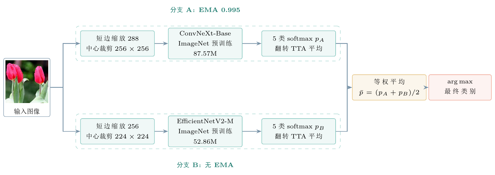

<div align="center">

# 花卉图像分类：设计还是迁移？

小规模五类花卉数据集上的网络结构、迁移学习与概率集成


</div>



## 项目简介

本项目在 3,670 张、5 个类别的花卉图像上，比较三种技术路线：从零训练的卷积网络、ImageNet 预训练模型微调，以及多模型概率集成。数据集规模小，且 roses 与 tulips 外观相近，因此项目同时处理了**重复图像泄漏**和**标签噪声**两个容易被忽略的问题。

最终方案将 ConvNeXt-Base（256 输入）与 EfficientNetV2-M（224 输入）的预测概率等权平均，在清洗后的测试集上取得 **97.43%** 的准确率和 **0.9737** 的宏平均 F1。完整实验过程、图表与分析见 [`reports/final_report/main.pdf`](reports/final_report/main.pdf)。

### 主要结果

| 方案 | 测试准确率 | 宏平均 F1 |
|---|---:|---:|
| SimpleCNN 基线（从零训练） | 84.76% | 0.8451 |
| 最佳自建模型（ResidualCNN + SE） | 86.39% | 0.8597 |
| 最佳预训练单模型 | 96.91% | — |
| 双模型概率集成（原始测试集） | 97.46% | — |
| 双模型概率集成（清洗后测试集，544 张） | **97.43%** | **0.9737** |

## 目录

- [项目简介](#项目简介)
- [项目结构](#项目结构)
- [环境要求与安装](#环境要求与安装)
- [快速开始](#快速开始)
- [完整流程](#完整流程)
- [最终方案与复现](#最终方案与复现)
- [数据集与标签说明](#数据集与标签说明)
- [实验报告](#实验报告)
- [测试与验证](#测试与验证)
- [致谢与参考](#致谢与参考)
- [许可证](#许可证)

## 项目结构

```text
ML-Flowers-Basic/
├─ src/                     # 数据处理、训练、集成与分析脚本
│  ├─ eda.py                # 数据集统计、重复检测与 EDA 图表
│  ├─ split_data.py         # 去重、分层 train/val/test 划分
│  ├─ dataset.py            # Dataset、数据增强与 DataLoader
│  ├─ preprocess.py         # 预处理校验与可视化
│  ├─ model.py              # SimpleCNN / ResidualCNN / 预训练主干
│  ├─ train.py              # 训练、EMA、TTA、评估与报告导出
│  ├─ ensemble.py           # 概率集成与验证集子集选择
│  ├─ analyze_errors.py     # 混淆类别与错分样本分析
│  ├─ audit_labels.py       # 基于不确定性的标签审核
│  ├─ clean_labels.py       # 应用人工复核结果，生成 splits_clean/
│  ├─ screen_nonflower.py   # 非花卉图像筛查
│  ├─ screen_objects.py     # 目标类别不符图像筛查
│  ├─ compare_experiments.py# 多组实验结果对比表
│  └─ make_report_figures.py# 生成报告图表数据
├─ splits/                  # 原始去重分层划分（CSV）
├─ splits_clean/            # 标签清洗后的划分（CSV）
├─ reports/
│  ├─ final_report/         # 实验报告 LaTeX 源码与 PDF
│  ├─ figures/              # 实验图表
│  ├─ tables/               # 指标 JSON
│  ├─ label_audit/          # 标签复核清单与证据
│  └─ exp_*/                # 各次实验的训练记录
├─ flower_photos/           # 数据集（本地，未纳入 Git）
├─ runs/                    # 检查点与训练日志（未纳入 Git）
├─ requirements.txt
├─ AGENTS.md                # 仓库开发约定
└─ README.md
```

## 环境要求与安装

- Python 3.12
- PyTorch 2.x（CUDA 13.0；CPU 也可运行，但训练会明显变慢）
- 依赖见 [`requirements.txt`](requirements.txt)

```powershell
python -m venv .venv
.\.venv\Scripts\Activate.ps1
python -m pip install -r requirements.txt
```

> `requirements.txt` 不锁定 CUDA 版本。使用 GPU 时，请按 [PyTorch 官方安装器](https://pytorch.org/get-started/locally/) 选择与本机驱动匹配的 wheel。

实验环境为单张 NVIDIA GeForce RTX 5090 Laptop GPU、混合精度训练，随机种子固定为 `42`。

## 快速开始

先把数据集放到 `flower_photos/`，目录结构为 `flower_photos/<类别>/*.jpg`。然后运行两个冒烟检查：

```powershell
# 检查模型结构与输出维度
python src/model.py

# 检查数据管道、增强与归一化
python src/preprocess.py --full-check
```

两者均无报错，说明环境和数据放置正确。

## 完整流程

```powershell
# 1. 数据探索：类别分布、尺寸、重复图像
python src/eda.py

# 2. 去重感知的分层划分（70/15/15）
python src/split_data.py --seed 42

# 3. 预处理与增强校验
python src/preprocess.py --full-check

# 4. 训练基线模型
python src/train.py --epochs 30 --batch-size 32

# 5. 训练预训练主干（示例）
python src/train.py --arch convnext_base --epochs 8 --lr 5e-5 `
  --weight-decay 0.01 --ema-decay 0.995 --tta `
  --out-dir runs/exp_convnext --reports-dir reports/exp_convnext

# 6. 评估单模型与概率集成
python src/ensemble.py `
  --checkpoints runs/exp_convnext/best.pt runs/exp_efficientnet/best.pt `
  --names convnext efficientnet
```

所有脚本都支持 `--help`，例如 `python src/train.py --help`。训练产物写入 `runs/`（检查点、日志），指标与图写入 `reports/`，两者默认均被 `.gitignore` 排除。

### 常用脚本参数

| 脚本 | 主要参数 | 说明 |
|---|---|---|
| `split_data.py` | `--seed` `--val-frac` `--test-frac` `--near-dup-dist` | 控制划分比例与近重复阈值 |
| `train.py` | `--arch` `--image-size` `--epochs` `--lr` `--ema-decay` `--tta` `--init-from` | 支持从检查点继续微调 |
| `ensemble.py` | `--checkpoints` `--names` `--no-tta` `--suffix` | 等权平均，并按验证集选择子集 |
| `audit_labels.py` | `--checkpoint` `--top-k` `--split` | 按预测不确定性导出可疑样本 |

## 最终方案与复现

最终模型由两个分支组成，均使用 ImageNet 预训练权重、EMA 和水平翻转 TTA：

| 分支 | 输入 | 关键配置 |
|---|---|---|
| ConvNeXt-Base | 256×256 | 从 224 检查点继续微调，EMA 0.995 |
| EfficientNetV2-M | 224×224 | 学习率 $5\times10^{-5}$，权重衰减 0.01 |

推理时对两个分支的类别概率取等权平均，不做加权搜索。模型选择只在验证集上进行，测试集仅用于最终报告。

标签清洗后的划分位于 `splits_clean/`：排除 57 张无关或错标图像后，train/val/test 分别为 2,527 / 538 / 544 张，且**没有重复图像簇跨越划分**。清洗决策与证据见 [`reports/label_audit/`](reports/label_audit/)。

## 数据集与标签说明

- 数据集共 5 类、3,670 张 JPEG 图像：daisy、dandelion、roses、sunflowers、tulips。
- 图像来自 TensorFlow 提供的 [flower_photos](http://download.tensorflow.org/example_images/flower_photos.tgz) 数据集（图片原始来源为 Flickr，版权与许可见原数据集页面）。
- 去重后实际使用 3,666 张参与划分；丢弃的 4 张包括精确重复与跨类别冲突样本。
- 数据集体积较大，不纳入 Git；`flower_photos/` 由 `.gitignore` 排除。仓库只保留划分清单 CSV，因此仅凭本仓库无法重跑训练，需要自行下载数据。
- 训练检查点（`runs/`、`*.pt`）同样不纳入 Git。

## 实验报告

完整实验报告见 [`reports/final_report/main.pdf`](reports/final_report/main.pdf)。

## 测试与验证

仓库目前没有单元测试框架，使用可执行脚本做回归检查：

```powershell
python src/model.py                  # 前向传播冒烟测试
python src/preprocess.py --full-check # 数据管道校验
```

数据相关改动应额外确认：图像张量为有限值 float32、标签计数与 CSV 一致、验证/测试变换确定、重复图像簇不跨划分。训练改动建议使用独立的 `--out-dir` 与 `--reports-dir`，保留基线结果以便对比。

## 致谢与参考

- 数据：TensorFlow `flower_photos` 数据集
- 预训练权重：[torchvision models](https://pytorch.org/vision/stable/models.html)
- 方法参考：ResNet、ConvNeXt、EfficientNetV2、Mixup、EMA、Confident Learning 等，完整文献见报告末尾的参考文献

## 许可证

本仓库为课程作业，暂未附带开源许可证。代码与报告仅供学习与评审参考；如需复用、修改或分发，请先联系作者。
