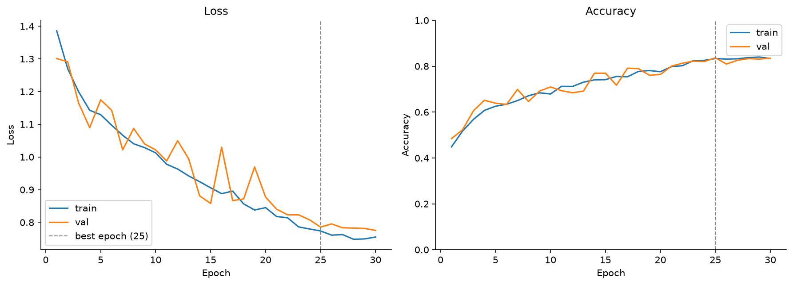
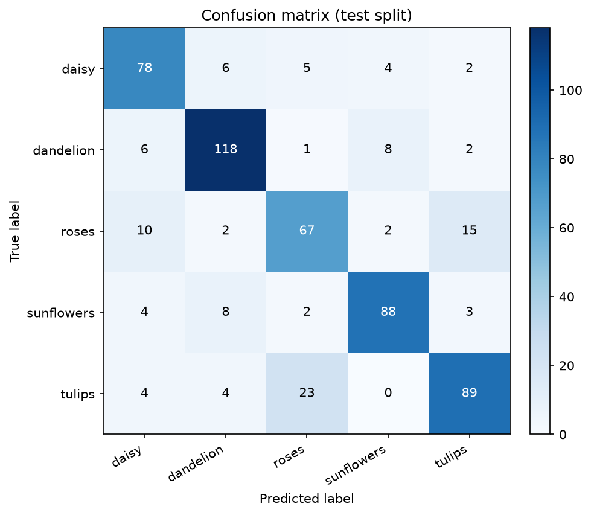
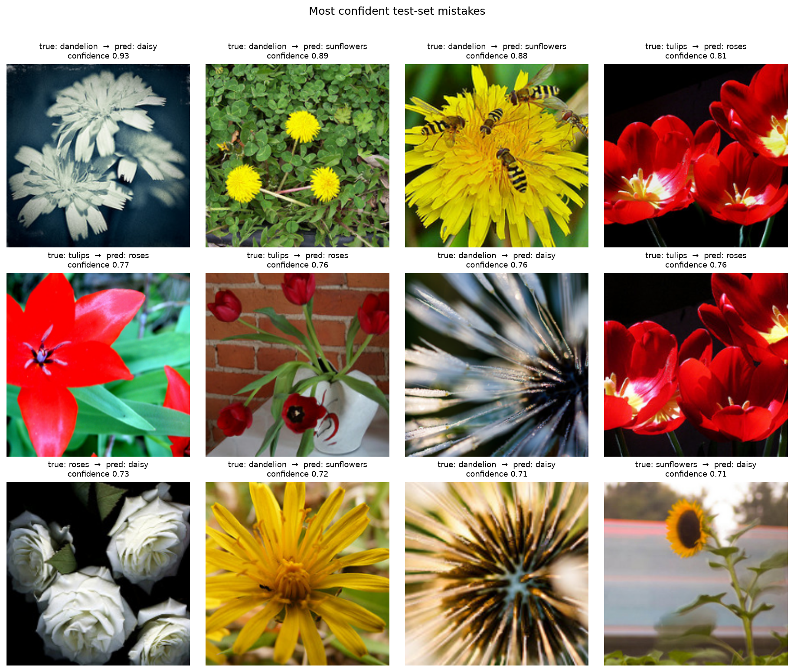

# CNN Baseline 训练报告

- 模型：`SimpleCNN`（4 个 conv block，Global Average Pooling，**1,174,501** 可训练参数）
- 输入：224×224，ImageNet 归一化；训练增强：RandomResizedCrop(0.65-1.0)、水平翻转、ColorJitter
- 优化：AdamW lr=0.001, weight_decay=0.0001, cosine schedule, label smoothing=0.1, AMP=True
- 训练：30 epochs（early stopping patience=8），batch size=32，seed=42

## 结果

| 指标 | 数值 |
|---|---:|
| 最佳 epoch | 25 |
| 最佳验证准确率 | 0.8367 |
| 测试准确率 | **0.7985** |
| 测试 Macro-F1 | **0.7936** |
| 测试错误数 | 12 / 551 |

## 各类别指标（test）

| 类别 | precision | recall | f1-score | support |
|---|---:|---:|---:|---:|
| daisy | 0.765 | 0.821 | 0.792 | 95 |
| dandelion | 0.855 | 0.874 | 0.864 | 135 |
| roses | 0.684 | 0.698 | 0.691 | 96 |
| sunflowers | 0.863 | 0.838 | 0.850 | 105 |
| tulips | 0.802 | 0.742 | 0.771 | 120 |
| **macro avg** | **0.794** | **0.795** | **0.794** | **551** |

## 训练曲线

## 混淆矩阵

## 高置信度错误样本

## 说明

- 这是**从零训练**的小型 CNN，不使用预训练权重，用于建立基线。
- 若验证/测试差距较大，说明过拟合，可加强增强、加大 weight decay 或改用预训练模型。
- 混淆矩阵可用于判断类别间的视觉相似性（如 daisy/tulips、dandelion/sunflowers）。
