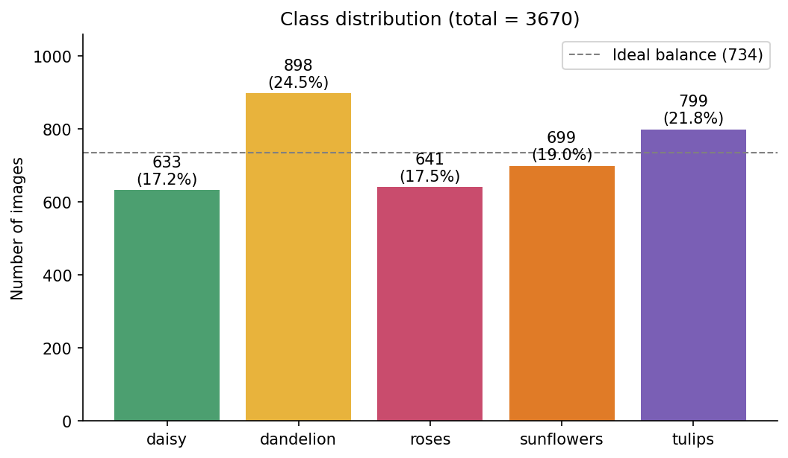
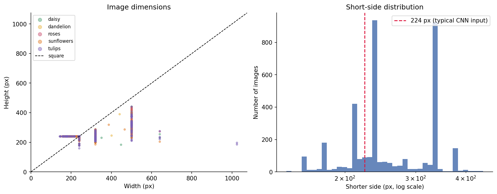
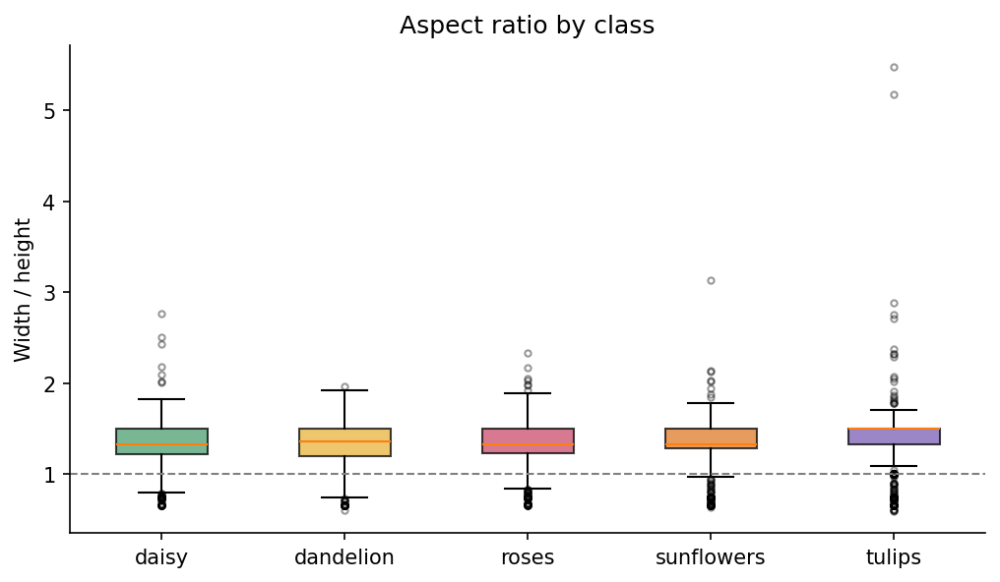
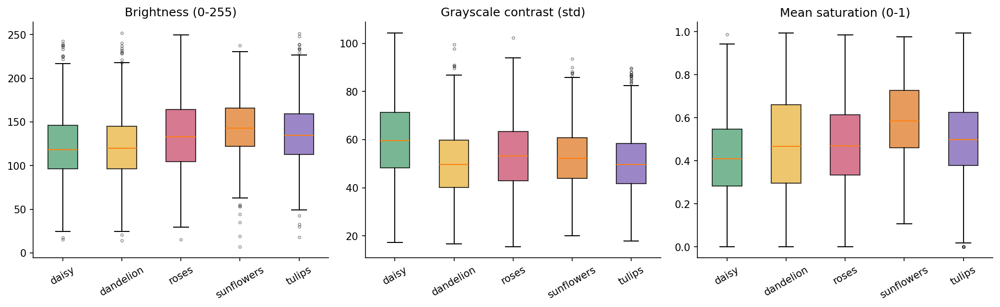
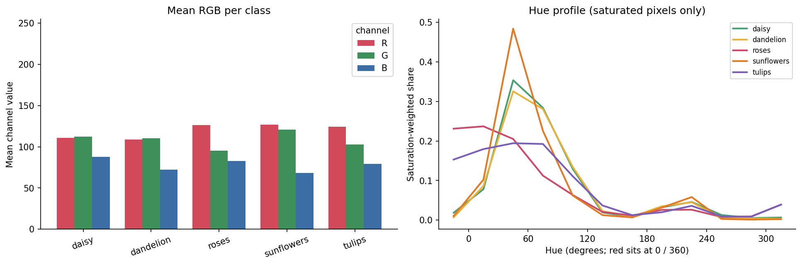
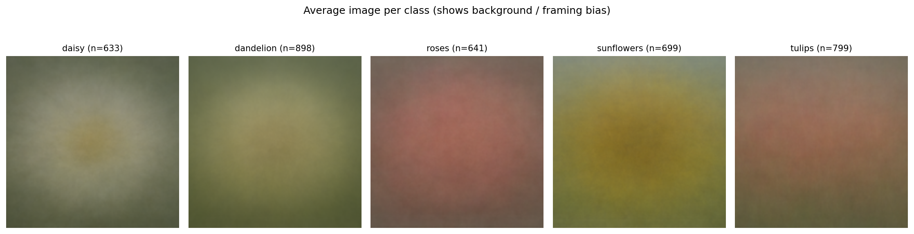
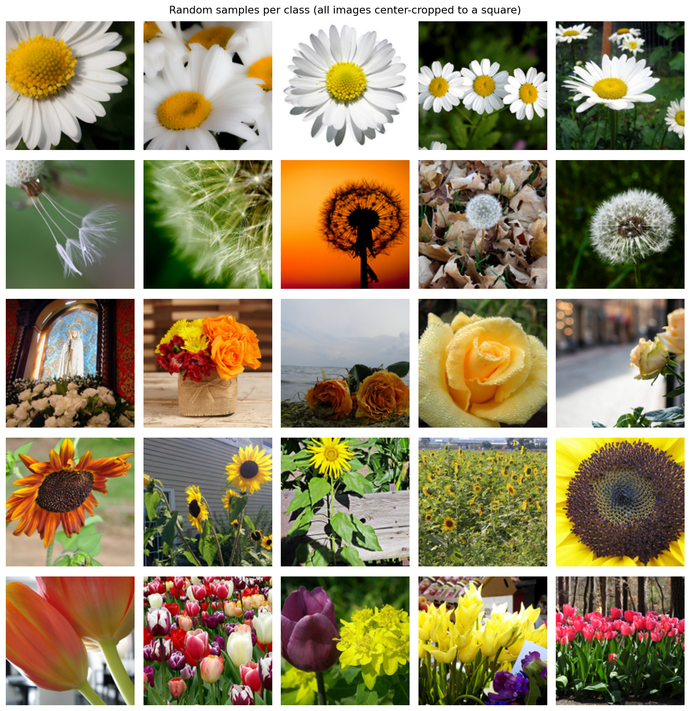
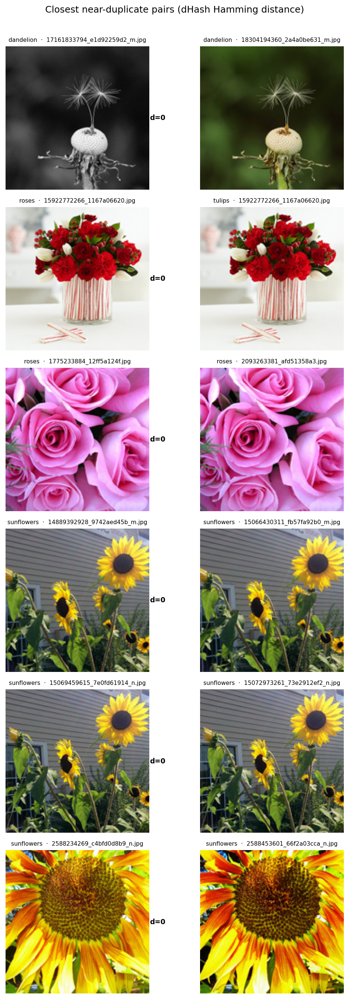

# 花卉数据集 EDA 报告

- 数据目录：`flower_photos/`
- 有效图片：**3670** 张，类别数：**5**
- 损坏/无法读取：**0** 张
- 类别：`daisy`, `dandelion`, `roses`, `sunflowers`, `tulips`

## 1. 数据集概况

| 类别 | 图片数 | 占比 | 平均宽×高 | 宽高比均值 | 最小边≥224px | 平均亮度 | 平均饱和度 |
|---|---:|---:|---|---:|---:|---:|---:|
| daisy | 633 | 17.2% | 359×271 | 1.31 | 72.5% | 123 | 0.42 |
| dandelion | 898 | 24.5% | 367×274 | 1.32 | 77.5% | 121 | 0.48 |
| roses | 641 | 17.5% | 364×275 | 1.31 | 79.1% | 134 | 0.47 |
| sunflowers | 699 | 19.0% | 360×270 | 1.32 | 73.4% | 143 | 0.59 |
| tulips | 799 | 21.8% | 372×269 | 1.37 | 65.0% | 137 | 0.51 |
| **合计** | **3670** | **100%** | — | — | **73.4%** | — | — |

类别不平衡比（最多/最少）为 **1.42**（dandelion 898 张 vs daisy 633 张）。
这个比例属于**轻度不平衡**，通常不需要过采样；使用分层划分 + `class_weight` 或按类别均衡采样即可。

## 2. 类别分布



```
daisy         633  ████████████████████████████
dandelion     898  ████████████████████████████████████████
roses         641  █████████████████████████████
sunflowers    699  ███████████████████████████████
tulips        799  ████████████████████████████████████
```

## 3. 图像尺寸与宽高比

- 宽度范围：143–1024 px（中位数 320）
- 高度范围：159–442 px（中位数 240）
- 宽高比：0.60–5.48，其中 7.3% 近似正方形，73.4% 的短边 ≥ 224 px
- 文件大小：中位数 45 KB，最大 275 KB
- 低于 100 px 的极小图：0 张
- 最常见分辨率：500×333（635 张），320×240（618 张），320×213（331 张），240×240（208 张），180×240（155 张）
  尺寸呈明显的离散簇，符合 Flickr 不同缩略图规格（500/320/240 px）的特征，而非连续分布。





**含义**：尺寸和宽高比差异很大，训练时不能直接 resize 到网络输入而不考虑形变；建议采用 `Resize(256) → CenterCrop(224)`（或随机裁剪）而非直接拉伸，并保留原始宽高比信息以检查数据泄漏式偏差。

## 4. 颜色与光照





各类别平均亮度在 121–143（0–255）之间，差异有限；但**色相分布差异明显**：`dandelion`/`sunflowers` 集中在黄橙色相，`roses` 偏红/品红，`daisy` 与 `tulips` 分布更分散。
这意味着仅用颜色直方图就能获得相当高的基线准确率；同时也要警惕模型学到「背景颜色/光照」而不是花朵形状，建议训练时使用颜色增强（jitter）并检查 Grad-CAM。



平均图显示各类存在明显的构图/背景差异（中心花朵、绿色背景占比不同），属于数据集中常见的**背景偏置**。

## 5. 样本示例



## 6. 重复与近重复检查

- 完全重复（文件 MD5 相同）：3 组，涉及 6 张；跨类别完全重复：1 组
- 近重复（dHash 汉明距离 ≤ 4）：17 对，构成 17 个簇，涉及 34 张（占 0.9%）
  - 其中同类别 16 对，跨类别 1 对
  - 簇大小分布：{2: 17}

**跨类别完全重复（同一张图片被放进两个类别，属于标签冲突）**：
- `roses/15922772266_1167a06620.jpg`; `tulips/15922772266_1167a06620.jpg`

近重复会造成**训练/验证泄漏**，使验证指标虚高。建议在划分数据集前按 dHash 聚类，把同一簇的图片整体分到同一 split，或直接剔除冗余图片。



## 7. 数据质量检查

- 损坏文件：0
- 色彩模式：{'RGB': 3670}
- 文件格式：{'JPEG': 3670}
- 扩展名与真实格式不一致：0 张
- 灰度/非 RGB 图片：0 张（已统一转为 RGB）

## 8. 建模建议

1. **划分**：分层 70/15/15（train/val/test），随机种子固定；约 2569 / 550 / 550 张。
2. **去重后再划分**：近重复簇整体归入同一 split，避免验证集泄漏。
3. **输入管线**：`Resize(256) → RandomResizedCrop(224) → RandomHorizontalFlip`，ImageNet 归一化；测试时 `Resize(256) → CenterCrop(224)`。
4. **分辨率**：73.4% 的图片短边 ≥ 224 px，先下采样到 224 不会损失太多信息；若追求更高精度可用 300–384 px。
5. **数据增强**：颜色抖动、随机裁剪、水平翻转、轻微旋转；避免过强的垂直翻转（花卉有朝向语义）。
6. **不平衡**：轻度不平衡，用分层采样即可；可对比 `class_weight` 与普通训练的效果。
7. **基线顺序**：颜色直方图 + Logistic Regression → 小型 CNN → ImageNet 预训练（ResNet18/EfficientNet-B0）微调；每步都记录混淆矩阵，重点看 daisy/tulips 与 dandelion/sunflowers 的混淆。
8. **可解释性**：用 Grad-CAM 检查模型是否聚焦花朵而非背景；若背景偏置严重，可尝试 RandomErasing / 更强裁剪。

## 9. 产物

- `reports/tables/image_metadata.csv`：每张图片的尺寸、颜色、亮度、哈希等元数据
- `reports/tables/class_summary.csv`：按类别聚合的统计量
- `reports/figures/*.png`：8 张分析图
- `src/eda.py`：可复现的 EDA 脚本
