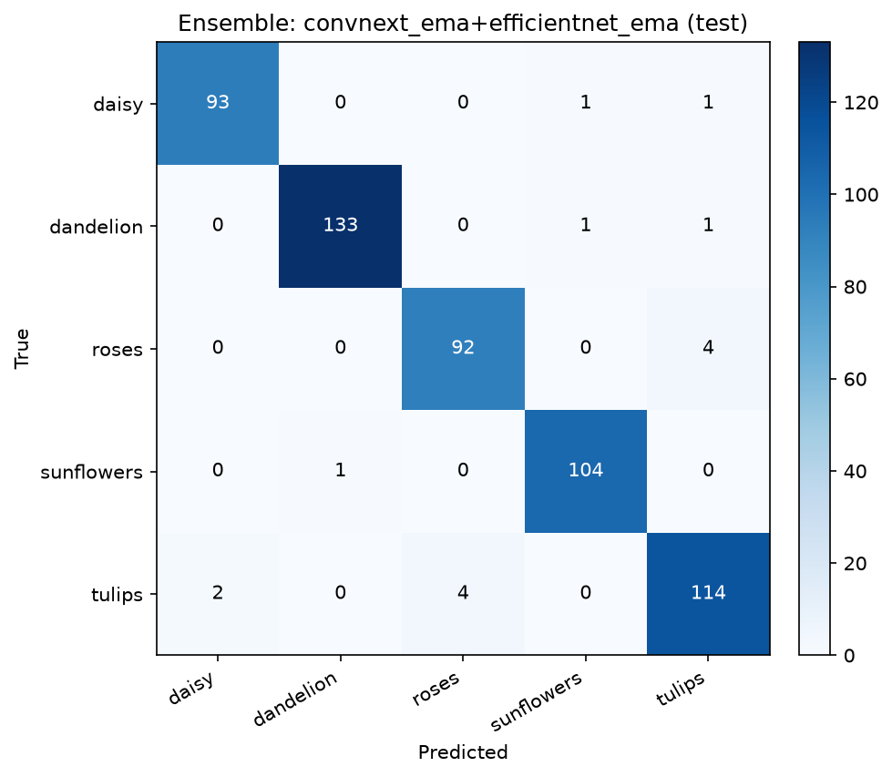

# 迁移模型集成结果

- 输入尺寸：224；TTA：horizontal flip
- 集成方式：等权概率平均；组合在 val 上选择

## 单模型

| 模型 | split | acc | macro F1 |
|---|---|---:|---:|
| convnext_ema | val | 0.9474 | 0.9469 |
| efficientnet_ema | val | 0.9383 | 0.9368 |
| mobilenet | val | 0.9238 | 0.9235 |
| convnext_ema | test | 0.9691 | 0.9683 |
| efficientnet_ema | test | 0.9673 | 0.9669 |
| mobilenet | test | 0.9220 | 0.9199 |

## 集成组合（按 val 排序，前 10）

| 组合 | val acc | val F1 | test acc | test F1 |
|---|---:|---:|---:|---:|
| convnext_ema+efficientnet_ema | 0.9510 | 0.9498 | 0.9728 | 0.9724 |
| convnext_ema | 0.9474 | 0.9469 | 0.9691 | 0.9683 |
| efficientnet_ema+mobilenet | 0.9474 | 0.9466 | 0.9619 | 0.9616 |
| convnext_ema+mobilenet | 0.9437 | 0.9436 | 0.9601 | 0.9595 |
| convnext_ema+efficientnet_ema+mobilenet | 0.9419 | 0.9407 | 0.9691 | 0.9688 |
| efficientnet_ema | 0.9383 | 0.9368 | 0.9673 | 0.9669 |
| mobilenet | 0.9238 | 0.9235 | 0.9220 | 0.9199 |

## 最终选择：convnext_ema+efficientnet_ema

| 类别 | precision | recall | f1 | support |
|---|---:|---:|---:|---:|
| daisy | 0.979 | 0.979 | 0.979 | 95 |
| dandelion | 0.993 | 0.985 | 0.989 | 135 |
| roses | 0.958 | 0.958 | 0.958 | 96 |
| sunflowers | 0.981 | 0.990 | 0.986 | 105 |
| tulips | 0.950 | 0.950 | 0.950 | 120 |

- val acc = 0.9510
- test acc = **0.9728**
- test macro F1 = **0.9724**

