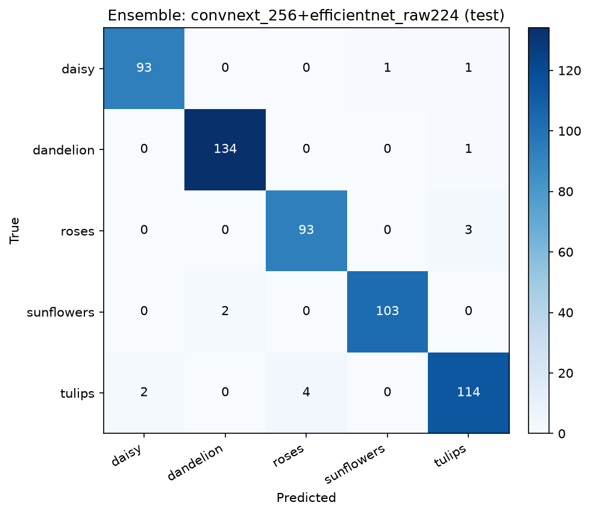

# 迁移模型集成结果

- 各模型使用自身训练分辨率（见下表）；TTA：horizontal flip
- 集成方式：等权概率平均；组合在 val 上选择

## 单模型

| 模型 | split | input | acc | macro F1 |
|---|---|---:|---:|---:|
| convnext_256 | val | 256 | 0.9601 | 0.9602 |
| convnext_ema224 | val | 224 | 0.9474 | 0.9469 |
| convnext_raw224 | val | 224 | 0.9564 | 0.9563 |
| efficientnet_ema224 | val | 224 | 0.9383 | 0.9368 |
| efficientnet_raw224 | val | 224 | 0.9401 | 0.9388 |
| convnext_256 | test | 256 | 0.9673 | 0.9669 |
| convnext_ema224 | test | 224 | 0.9691 | 0.9683 |
| convnext_raw224 | test | 224 | 0.9673 | 0.9666 |
| efficientnet_ema224 | test | 224 | 0.9673 | 0.9669 |
| efficientnet_raw224 | test | 224 | 0.9673 | 0.9671 |

## 集成组合（按 val 排序，前 10）

| 组合 | val acc | val F1 | test acc | test F1 |
|---|---:|---:|---:|---:|
| convnext_256+efficientnet_raw224 | 0.9637 | 0.9634 | 0.9746 | 0.9742 |
| convnext_256+convnext_ema224+efficientnet_raw224 | 0.9619 | 0.9617 | 0.9728 | 0.9721 |
| convnext_256+convnext_raw224+efficientnet_raw224 | 0.9619 | 0.9617 | 0.9728 | 0.9721 |
| convnext_256 | 0.9601 | 0.9602 | 0.9673 | 0.9669 |
| convnext_256+convnext_raw224+efficientnet_ema224 | 0.9601 | 0.9598 | 0.9710 | 0.9704 |
| convnext_raw224+efficientnet_raw224 | 0.9601 | 0.9596 | 0.9746 | 0.9742 |
| convnext_256+convnext_ema224 | 0.9583 | 0.9583 | 0.9710 | 0.9705 |
| convnext_256+convnext_ema224+efficientnet_ema224 | 0.9583 | 0.9580 | 0.9710 | 0.9704 |
| convnext_256+convnext_ema224+convnext_raw224+efficientnet_ema224 | 0.9583 | 0.9580 | 0.9710 | 0.9704 |
| convnext_ema224+convnext_raw224+efficientnet_ema224 | 0.9583 | 0.9576 | 0.9691 | 0.9685 |

## 最终选择：convnext_256+efficientnet_raw224

| 类别 | precision | recall | f1 | support |
|---|---:|---:|---:|---:|
| daisy | 0.979 | 0.979 | 0.979 | 95 |
| dandelion | 0.985 | 0.993 | 0.989 | 135 |
| roses | 0.959 | 0.969 | 0.964 | 96 |
| sunflowers | 0.990 | 0.981 | 0.986 | 105 |
| tulips | 0.958 | 0.950 | 0.954 | 120 |

- val acc = 0.9637
- test acc = **0.9746**
- test macro F1 = **0.9742**

