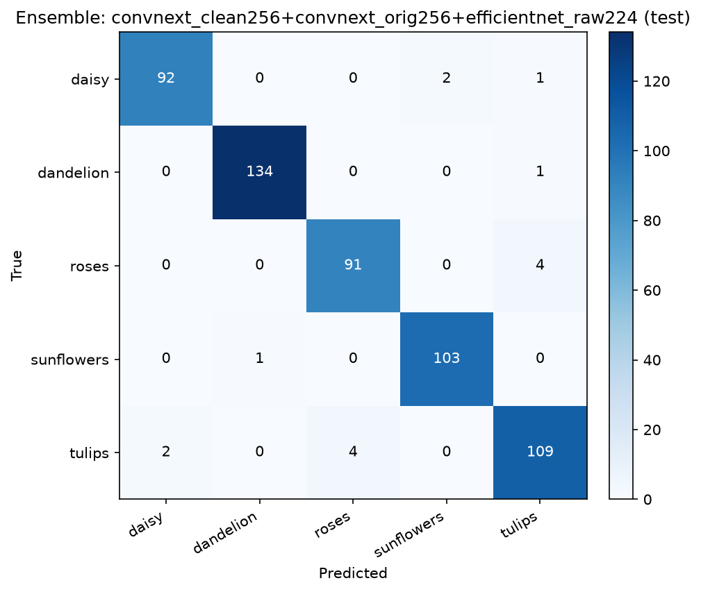

# 迁移模型集成结果

- 各模型使用自身训练分辨率（见下表）；TTA：horizontal flip
- 集成方式：等权概率平均；组合在 val 上选择

## 单模型

| 模型 | split | input | acc | macro F1 |
|---|---|---:|---:|---:|
| convnext_clean256 | val | 256 | 0.9684 | 0.9683 |
| convnext_orig256 | val | 256 | 0.9684 | 0.9683 |
| efficientnet_raw224 | val | 224 | 0.9442 | 0.9424 |
| convnext_clean256 | test | 256 | 0.9669 | 0.9661 |
| convnext_orig256 | test | 256 | 0.9688 | 0.9680 |
| efficientnet_raw224 | test | 224 | 0.9669 | 0.9665 |

## 集成组合（按 val 排序，前 10）

| 组合 | val acc | val F1 | test acc | test F1 |
|---|---:|---:|---:|---:|
| convnext_clean256+convnext_orig256+efficientnet_raw224 | 0.9703 | 0.9703 | 0.9724 | 0.9715 |
| convnext_orig256+efficientnet_raw224 | 0.9703 | 0.9696 | 0.9743 | 0.9737 |
| convnext_orig256 | 0.9684 | 0.9683 | 0.9688 | 0.9680 |
| convnext_clean256 | 0.9684 | 0.9683 | 0.9669 | 0.9661 |
| convnext_clean256+convnext_orig256 | 0.9665 | 0.9663 | 0.9669 | 0.9661 |
| convnext_clean256+efficientnet_raw224 | 0.9665 | 0.9660 | 0.9743 | 0.9737 |
| efficientnet_raw224 | 0.9442 | 0.9424 | 0.9669 | 0.9665 |

## 最终选择：convnext_clean256+convnext_orig256+efficientnet_raw224

| 类别 | precision | recall | f1 | support |
|---|---:|---:|---:|---:|
| daisy | 0.979 | 0.968 | 0.974 | 95 |
| dandelion | 0.993 | 0.993 | 0.993 | 135 |
| roses | 0.958 | 0.958 | 0.958 | 95 |
| sunflowers | 0.981 | 0.990 | 0.986 | 104 |
| tulips | 0.948 | 0.948 | 0.948 | 115 |

- val acc = 0.9703
- test acc = **0.9724**
- test macro F1 = **0.9715**

