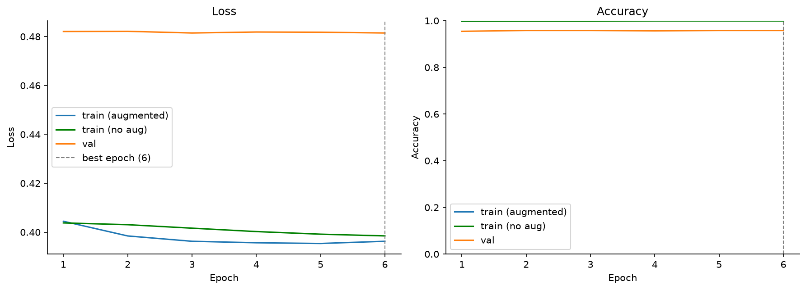
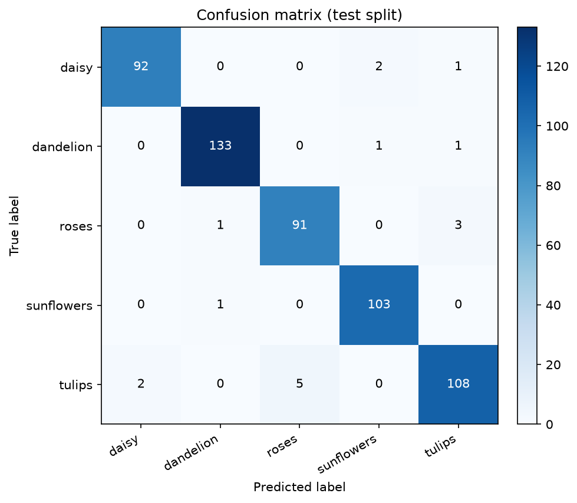
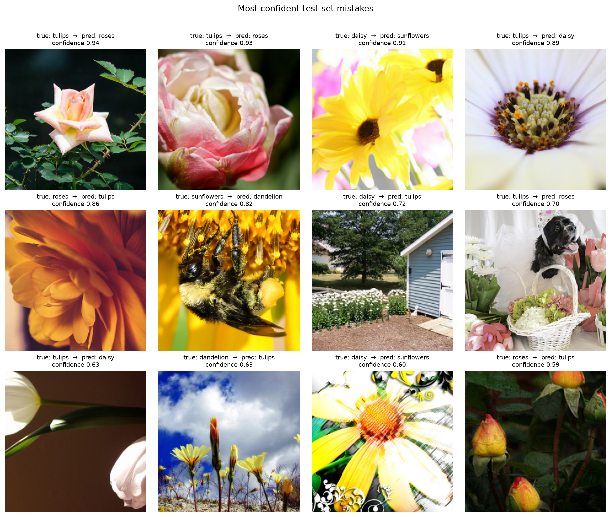

# CNN Baseline 训练报告

- 模型：`ConvNeXt-Base (pretrained)`（ImageNet 预训练，全部参数微调，**87,571,589** 可训练参数）
- 输入：256×256（验证 Resize(288) → CenterCrop(256)），ImageNet 归一化；训练增强：RandomResizedCrop(0.65-1.0)、水平翻转、ColorJitter(hue=0.05)
- 优化：AdamW lr=2e-05, weight_decay=0.01, cosine schedule, label smoothing=0.1, AMP=True, EMA decay=0.995, test TTA=horizontal flip
- 训练：6 epochs（early stopping patience=6），batch size=32，seed=42
- 诊断指标：每轮训练后用**验证预处理**（无增强、dropout off）再评估一次训练集，得到可与 val 直接比较的 `train_eval_acc`

## 结果

| 指标 | 数值 |
|---|---:|
| 最佳 epoch | 6 |
| 最佳验证准确率 | 0.9583 |
| 最佳 epoch 训练集准确率（无增强） | 0.9992 |
| 验证 - 训练差距 | -0.0410 |
| 测试准确率 | **0.9688** |
| 测试 Macro-F1 | **0.9680** |
| 测试错误数 | 17 / 544 |

**拟合诊断**：验证集与无增强训练集仅差 4.1 个百分点，拟合程度合理，瓶颈更可能在模型容量或数据本身。

## 各类别指标（test）

| 类别 | precision | recall | f1-score | support |
|---|---:|---:|---:|---:|
| daisy | 0.979 | 0.968 | 0.974 | 95 |
| dandelion | 0.985 | 0.985 | 0.985 | 135 |
| roses | 0.948 | 0.958 | 0.953 | 95 |
| sunflowers | 0.972 | 0.990 | 0.981 | 104 |
| tulips | 0.956 | 0.939 | 0.947 | 115 |
| **macro avg** | **0.968** | **0.968** | **0.968** | **544** |

## 训练曲线

## 混淆矩阵

## 高置信度错误样本

## 说明

- 这是**从零训练**的小型 CNN，不使用预训练权重，用于建立基线。
- 若验证/测试差距较大，说明过拟合，可加强增强、加大 weight decay 或改用预训练模型。
- 混淆矩阵可用于判断类别间的视觉相似性（如 daisy/tulips、dandelion/sunflowers）。
