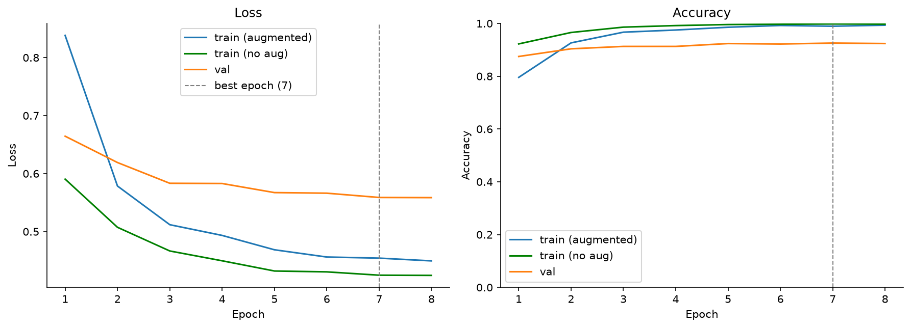
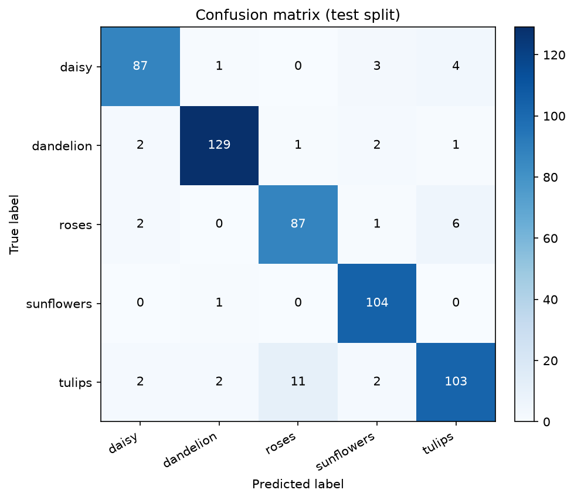
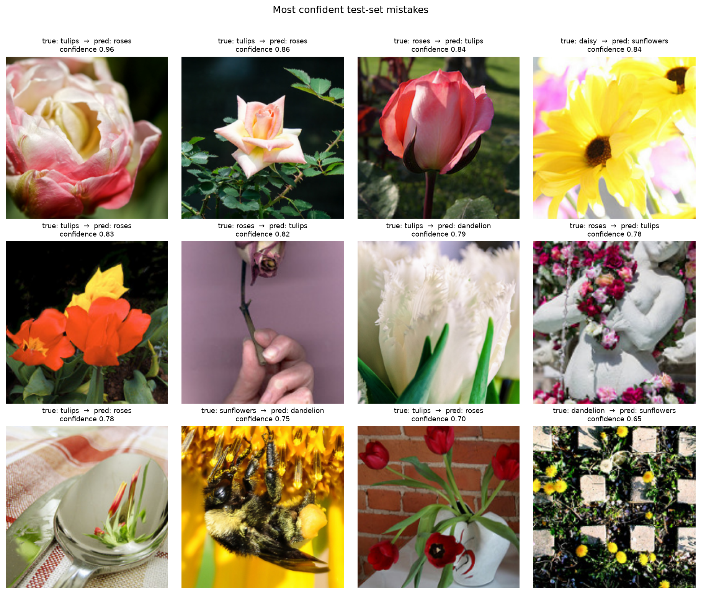

# CNN Baseline 训练报告

- 模型：`MobileNetV3-Small (pretrained)`（ImageNet 预训练，全部参数微调，**1,522,981** 可训练参数）
- 输入：224×224，ImageNet 归一化；训练增强：RandomResizedCrop(0.65-1.0)、水平翻转、ColorJitter(hue=0.05)
- 优化：AdamW lr=0.0003, weight_decay=0.0001, cosine schedule, label smoothing=0.1, AMP=True
- 训练：8 epochs（early stopping patience=8），batch size=32，seed=42
- 诊断指标：每轮训练后用**验证预处理**（无增强、dropout off）再评估一次训练集，得到可与 val 直接比较的 `train_eval_acc`

## 结果

| 指标 | 数值 |
|---|---:|
| 最佳 epoch | 7 |
| 最佳验证准确率 | 0.9256 |
| 最佳 epoch 训练集准确率（无增强） | 0.9980 |
| 验证 - 训练差距 | -0.0725 |
| 测试准确率 | **0.9256** |
| 测试 Macro-F1 | **0.9239** |
| 测试错误数 | 41 / 551 |

**拟合诊断**：验证集比无增强训练集低 7.2 个百分点，存在一定过拟合；可加强增强、提高 weight decay、使用 EMA 或增加数据。

## 各类别指标（test）

| 类别 | precision | recall | f1-score | support |
|---|---:|---:|---:|---:|
| daisy | 0.935 | 0.916 | 0.926 | 95 |
| dandelion | 0.970 | 0.956 | 0.963 | 135 |
| roses | 0.879 | 0.906 | 0.892 | 96 |
| sunflowers | 0.929 | 0.990 | 0.959 | 105 |
| tulips | 0.904 | 0.858 | 0.880 | 120 |
| **macro avg** | **0.923** | **0.925** | **0.924** | **551** |

## 训练曲线

## 混淆矩阵

## 高置信度错误样本

## 说明

- 这是**从零训练**的小型 CNN，不使用预训练权重，用于建立基线。
- 若验证/测试差距较大，说明过拟合，可加强增强、加大 weight decay 或改用预训练模型。
- 混淆矩阵可用于判断类别间的视觉相似性（如 daisy/tulips、dandelion/sunflowers）。
