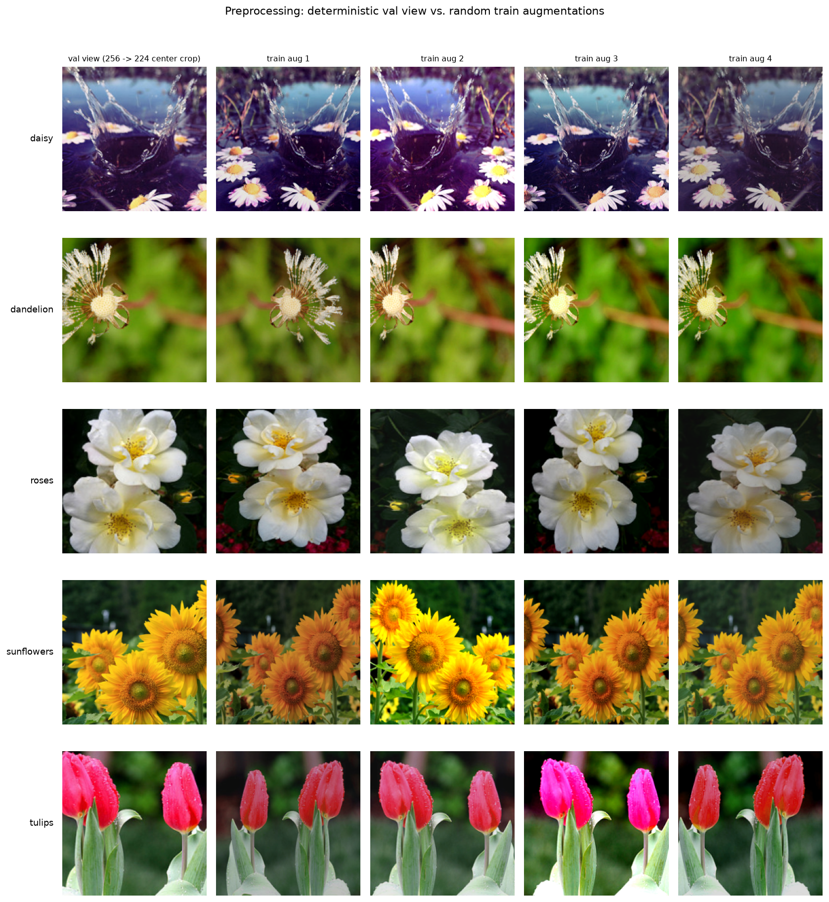

# 数据预处理报告

- 数据目录：`flower_photos`
- 划分清单：`splits`
- 训练输入尺寸：**224×224**；验证/测试先缩放短边到 **256** 再中心裁剪
- 归一化：ImageNet 均值 `(0.485, 0.456, 0.406)`，标准差 `(0.229, 0.224, 0.225)`
- 总图片数：**3666**

## 各 split 张量检查

| split | 检查张数 | 张量形状 | 像素范围 | 通道均值 (R,G,B) | 通道标准差 (R,G,B) |
|---|---:|---|---|---|---|
| train | 96 | (3, 224, 224) | -2.12 ~ 2.64 | [-0.0723, -0.1291, -0.4523] | [1.3167, 1.2152, 1.2629] |
| val | 96 | (3, 224, 224) | -2.12 ~ 2.64 | [-0.0283, 0.0551, -0.1911] | [1.338, 1.2799, 1.4305] |
| test | 96 | (3, 224, 224) | -2.12 ~ 2.64 | [0.0638, 0.1982, -0.1141] | [1.3095, 1.2432, 1.4611] |

张量已转为 float32 并完成归一化，因此像素范围不再固定在 [0, 1]；均值和标准差偏离 0/1 是因为花卉图像的色彩分布与 ImageNet 不同（尤其绿色背景）。

## 训练增强

1. `RandomResizedCrop(224, scale=(0.65, 1.0), ratio=(0.8, 1.25))`：随机缩放 + 宽高比扰动
2. `RandomHorizontalFlip(p=0.5)`：水平翻转
3. `ColorJitter(0.2, 0.2, 0.2, 0.05)`：亮度/对比度/饱和度/色调扰动
4. `ToImage → float32 [0,1] → Normalize(ImageNet)`

验证/测试只做 `Resize(256) → CenterCrop(224) → Normalize`，保证可复现。

## 归一化统计

- 当前使用：ImageNet mean = `(0.485, 0.456, 0.406)`，std = `(0.229, 0.224, 0.225)`
- 训练集自身统计（1000 张，[0,1] 范围）：mean = `(0.4832, 0.48, 0.3463)`，std = `(0.288, 0.2605, 0.3044)`
- 若从零训练可改用上述统计；微调 ImageNet 预训练模型时保持 ImageNet 统计更合适。

## 校验结果

- 验证集确定性：通过（同一张图两次输出完全一致）
- 所有检查批次均为有限值、float32、形状 (3, H, W)

## 示例

